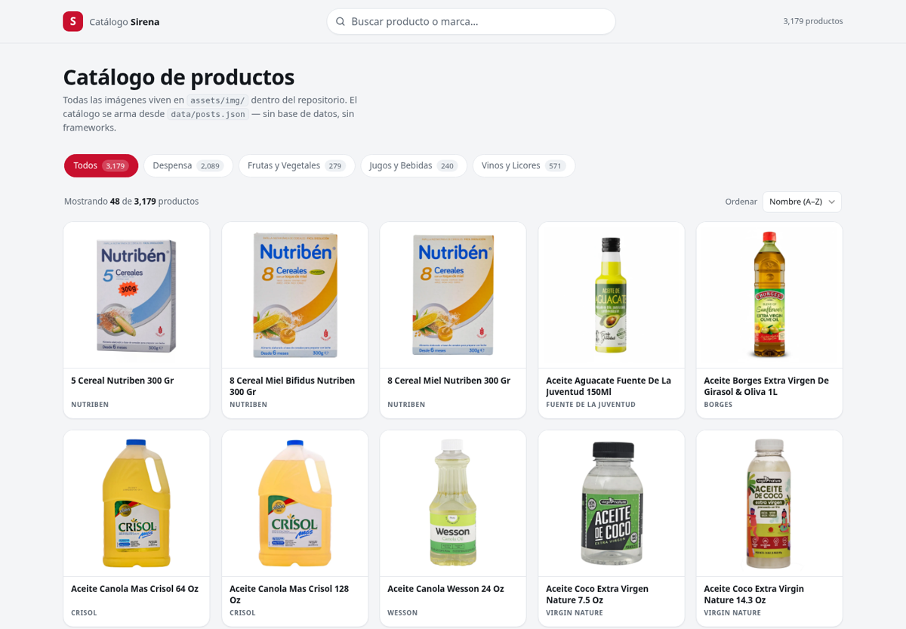
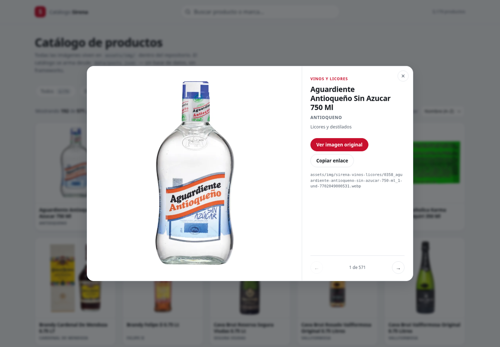
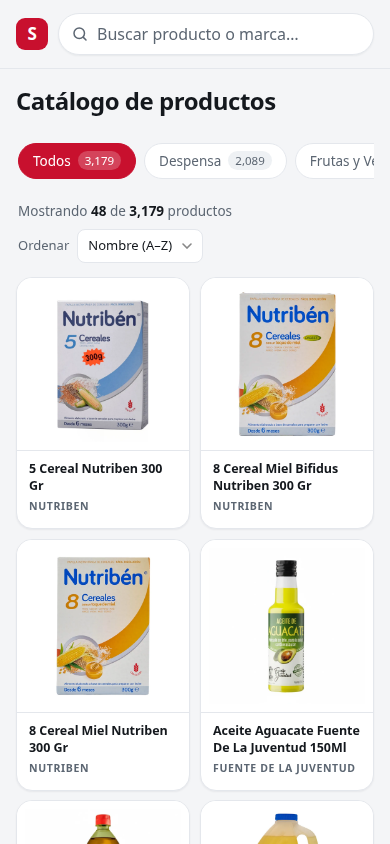

# Catálogo Sirena — HTML + CSS + JavaScript puro

Catálogo de productos **100 % estático**: las fotos viven en el repositorio, el
catálogo se arma con un `posts.json` generado automáticamente y el navegador lo
lee con `fetch()`. **Sin base de datos, sin backend, sin frameworks.** Listo para
GitHub Pages.

> **TL;DR** — Sube fotos a `assets/img/<categoria>/`, ejecuta `npm run build`,
> haz commit y push. El sitio muestra lo nuevo sin tocar una línea de HTML.

## Vista previa

| Escritorio | Detalle de producto |
| --- | --- |
|  |  |

<p align="center">
  
</p>

---

## 1. Estructura del proyecto

```
.
├── index.html                  ← única página del sitio
├── css/
│   └── styles.css              ← estilos (grid, tarjetas, modo oscuro, dialog)
├── js/
│   ├── app.js                  ← fetch + filtros + render + detalle
│   └── lib.js                  ← funciones puras (búsqueda, hash, orden)
├── data/
│   ├── posts.json              ← "base de datos" estática (GENERADA)
│   ├── labels.json             ← nombres visibles de cada categoría (opcional)
│   └── manifests/              ← CSV de origen con títulos/marcas reales
│       ├── sirena-despensa.csv
│       ├── sirena-frutas-y-vegetales.csv
│       ├── sirena-jugos.csv
│       ├── sirena-vinos-licores.csv
│       └── sirena-carnes-pescados-y-mariscos.csv
├── assets/
│   ├── img/                    ← originales (se usan en el detalle)
│   │   ├── sirena-despensa/            ← 2 089 imágenes
│   │   ├── sirena-frutas-y-vegetales/  ←   279 imágenes
│   │   ├── sirena-jugos/               ←   240 imágenes
│   │   ├── sirena-vinos-licores/       ←   571 imágenes
│   │   └── sirena-carnes-pescados-y-mariscos/ ← 548 imágenes
│   └── thumbs/                 ← miniaturas 480px (las usa la galería)
├── tools/
│   ├── generate-posts.mjs      ← escanea carpetas y genera posts.json
│   ├── generate-thumbs.mjs     ← genera las miniaturas WebP
│   └── serve.mjs               ← servidor local (fetch no funciona en file://)
├── tests/                      ← pruebas de lib.js y del generador
├── _no-publicar/               ← duplicados que NO se suben (ignorado por git)
├── package.json
└── .github/workflows/generate-posts.yml   ← automatización opcional
```

> El archivo `sirena-carnes-pescados-y-mariscos.csv` de manifiesto es opcional:
> si no existe, los títulos se derivan de los nombres de archivo (que ya son
> descriptivos). Los 53+ duplicados se guardan en `_no-publicar/`.

**Regla de oro:** una carpeta de primer nivel dentro de `assets/img/` = una
categoría del catálogo. El nombre de la carpeta se usa como URL y como filtro.

### Nombres recomendados

| Elemento | Convención | Ejemplo |
| --- | --- | --- |
| Carpeta | minúsculas, guiones, sin acentos ni espacios | `sirena-despensa` |
| Imagen | `NNNN_descripcion-corta_1-und_codigo.webp` | `0002_cafe-molido-santo-domingo-1-lb_1-und-748325000038.webp` |
| Extensión | `.webp` (o `.jpg`, `.png`, `.avif`) | — |
| Carpeta de descartes | empieza con `_` → se ignora | `_duplicados/` |

El generador **ignora** cualquier archivo o carpeta que empiece con `.` o `_`, así
que puedes guardar duplicados o material sin publicar dentro de `assets/img/`
sin que aparezcan en el sitio.

---

## 2. `data/posts.json` — el "banco de datos"

Formato real que produce el generador (recortado a dos posts):

```json
{
  "version": 1,
  "generatedAt": "2026-11-14T17:20:31.402Z",
  "count": 3179,
  "categories": [
    { "slug": "sirena-despensa", "label": "Despensa", "count": 2089 },
    { "slug": "sirena-jugos", "label": "Jugos y Bebidas", "count": 240 }
  ],
  "posts": [
    {
      "title": "Café Molido Santo Domingo 1 Lb",
      "image": "assets/img/sirena-despensa/0002_cafe-molido-santo-domingo-1-lb_1-und-748325000038.webp",
      "category": "sirena-despensa",
      "brand": "SANTO DOMINGO",
      "subcategory": "Café y Té > Café"
    },
    {
      "title": "Jugo de Naranja Rica 1 L",
      "image": "assets/img/sirena-jugos/0131_jugo-rica-manzana-1-l_1-und-790330050072.webp",
      "category": "sirena-jugos",
      "brand": "RICA",
      "subcategory": "Bebidas > Jugos"
    }
  ]
}
```

| Campo | Obligatorio | Uso |
| --- | --- | --- |
| `title` | sí | texto de la tarjeta y del detalle |
| `image` | sí | ruta **relativa** a la raíz del sitio |
| `category` | sí | filtro por categoría (la carpeta) |
| `brand`, `subcategory` | no | se muestran si existen y entran en la búsqueda |

`id` no se guarda: se deriva de `categoria + nombre-del-archivo`, por eso los
enlaces profundos (`#/p/sirena-despensa%2F0002_cafe...`) son estables aunque
regeneres el JSON.

El archivo se escribe con **un post por línea**: sigue siendo JSON válido, pesa
casi igual que el minificado y hace que los diffs de Git sean legibles (subir una
foto nueva = una línea nueva). Si prefieres indentación completa, usa
`npm run build:pretty`.

---

## 3. Cómo funciona la lectura (`fetch` + DOM)

`js/app.js` hace, en orden:

1. **`fetch('data/posts.json', { cache: 'no-cache' })`** — pide el JSON al
   servidor (o a GitHub Pages). Si la respuesta no es `ok`, muestra un error
   explicativo.
2. **Normaliza** cada post y precalcula un texto de búsqueda sin acentos
   (`Café` → `cafe`), para que buscar "cafe" encuentre "Café".
3. **Renderiza por lotes de 48 tarjetas** con `document.createDocumentFragment()`
   y `<template>`; las imágenes usan `loading="lazy"` y `decoding="async"`.
   Al llegar al final (o pulsar *Cargar más*) se añade el siguiente lote.
4. **Filtra y ordena en memoria** con funciones puras de `js/lib.js`.
5. **Detalle con `<dialog>`**: cada tarjeta enlaza a `#/p/<id>`; eso permite
   compartir un producto por URL y usar el botón *Atrás* del navegador.

Los conceptos que pediste están todos aquí: *fetch API*, *JSON parsing*,
*DOM manipulation*, *event delegation* y despliegue en *GitHub Pages*.

---

## 4. Ejecutar en local

`fetch()` **no funciona** si abres `index.html` con doble clic (`file://`). Usa
el servidor incluido (sin dependencias):

```bash
npm run dev          # http://127.0.0.1:8080
# o bien:
PORT=3000 npm run dev
python3 -m http.server 8080   # alternativa
```

---

## 5. Generar `posts.json` automáticamente

```bash
npm run build
# ✔ 3727 posts generados
#   Carnes, Pescados y Mariscos: 548 · Despensa: 2089 · Frutas y Vegetales: 279
#   Jugos y Bebidas: 240 · Vinos y Licores: 571
```

El script `tools/generate-posts.mjs`:

- Recorre `assets/img/**` (ignora `.` y `_`).
- Busca títulos reales en `data/manifests/<carpeta>.csv` (columna `archivo`).
  Si no hay CSV, deriva el título del nombre del archivo.
- Aplica los nombres visibles de `data/labels.json`.
- Omite filas del CSV cuya imagen no exista en disco y avisa de cuántas fueron.
- Ordena alfabéticamente y escribe `data/posts.json` (≈ 920 KB para 3 727 posts).

Opciones:

```bash
node tools/generate-posts.mjs --base "https://cdn.ejemplo.com/"   # imágenes en un CDN
node tools/generate-posts.mjs --out data/posts.json --pretty
node tools/generate-posts.mjs --img assets/img --manifests data/manifests --labels data/labels.json
```

**¿Cuándo ejecutarlo?** Cada vez que agregues, quites o renombres imágenes.
Con la GitHub Action de la sección 8 se hace solo al hacer push.

---

## 6. Añadir fotos nuevas (flujo de 3 pasos)

1. Copia la carpeta nueva dentro de `assets/img/`:
   `assets/img/sirena-lacteos/`
2. (Opcional) Si quieres títulos/marcas reales, agrega
   `data/manifests/sirena-lacteos.csv` con las mismas columnas que los demás.
3. Genera miniaturas, regenera el JSON y publica:

```bash
npm run thumbs     # solo las fotos nuevas (incremental)
npm run build
git add .
git commit -m "Agregar categoría lacteos"
git push
```

No hay que editar `index.html` ni `app.js`: los chips de categoría, los filtros y
las tarjetas salen del JSON.

### Miniaturas = velocidad

Con miles de fotos de 1000×1000, la galería se vuelve pesada. Por eso el sitio
muestra **miniaturas WebP de 480 px** (≈ 14 KB en vez de 55 KB) y solo carga el
original cuando abres el detalle:

- `npm run thumbs` genera `assets/thumbs/**` de forma **incremental** (si ya
  existe y no cambió la foto, no la repite).
- `npm run build:all` equivale a `thumbs` + `build`.
- Si una miniatura falta, la tarjeta cae automáticamente al original.

El servidor local ya comprime `posts.json` con gzip (≈ 920 KB → ≈ 120 KB) y sirve
las imágenes con caché, igual que GitHub Pages.

---

## 7. Publicar en GitHub Pages

```bash
# 1. Crea el repositorio vacío en GitHub y luego:
git init
git add .
git commit -m "Catálogo inicial"
git branch -M main
git remote add origin https://github.com/TU-USUARIO/TU-REPO.git
git push -u origin main
```

2. En GitHub: **Settings → Pages → Build and deployment → Source: Deploy from a
   branch**, rama `main`, carpeta `/ (root)`. Guarda.
3. Espera 1–2 minutos. Tu catálogo queda en
   `https://TU-USUARIO.github.io/TU-REPO/`.

Las rutas del JSON son relativas (`assets/img/...`), así que funcionan igual en
la raíz del dominio o en un subdirectorio de proyecto.

### Publicar en Vercel (alternativa)

El sitio es 100% estático, así que Vercel solo sirve los archivos del repo
(sin build, sin backend). El `vercel.json` ya configura el directorio de salida
(`.`) y la caché: las imágenes en `assets/` se sirven con
`Cache-Control: immutable` (un año) y `posts.json` se revalida en cada visita.

1. `git init`, `git add .`, `git commit`, `git push` (igual que arriba).
2. En Vercel: **Add New → Project → Import** tu repositorio.
3. Framework Preset: **Other** · Build Command: *(vacío)* ·
   Output Directory: `.` (o déjalo, lo toma de `vercel.json`).
4. **Deploy**. Queda en `https://TU-PROYECTO.vercel.app`.

Como `posts.json` usa rutas relativas y la navegación es por hash (`#/p/…`), no
hace falta configurar rewrites ni rutas: Vercel sirve `index.html` en la raíz y
listo. El `.nojekyll` no molesta a Vercel.

> **Límites de Vercel (Hobby):** 15 000 archivos por despliegue y 100 MB por
> archivo. Con ~7 480 archivos (originales + miniaturas) estás lejos del tope,
> pero tenlo en mente si algún día superas ~15 000 archivos (ahí convendría un
> CDN o agrupar). El `_no-publicar/` no se sube (está en `.gitignore`), así que
> no cuenta.

> **Tamaño:** GitHub recomienda repositorios menores a 1 GB y rechaza archivos
> de más de 100 MB. Ahora tienes ~206 MB de originales + ~56 MB de miniaturas,
> dentro del límite, pero **el primer `git push` de cientos de MB puede tardar
> varios minutos** (es normal; los siguientes pushes solo suben lo nuevo). Si
> quieres aligerarlo: (a) no subas `assets/img/` originales y sirve el detalle
> con la miniatura, o (b) mueve todo a un CDN y usa `--base`.

---

## 8. Automatización opcional (GitHub Actions)

`.github/workflows/generate-posts.yml` regenera las miniaturas y `posts.json` en
cada push que toque `assets/img/`, `data/manifests/` o `data/labels.json`, y hace
commit del resultado. Así **subir fotos y hacer push es todo**: no ejecutas nada
a mano (el runner de GitHub ya trae `ffmpeg`).

Para usarla:

1. Sube el workflow al repositorio.
2. **Settings → Actions → General → Workflow permissions** →
   *Read and write permissions* → Guardar.
3. Sube una carpeta de imágenes y observa la pestaña **Actions**.

---

## 9. Pruebas

```bash
npm test
# 19 pruebas: normalización de búsqueda, hashes, orden, CSV,
# título desde nombre de archivo, miniaturas y una generación completa.
```

---

## 10. Personalización rápida

| Quiero… | Dónde |
| --- | --- |
| Cambiar el nombre visible de una categoría | `data/labels.json` |
| Cambiar colores / tipografía | variables CSS al inicio de `css/styles.css` |
| Mostrar más/menos tarjetas por lote | `PAGE_SIZE` en `js/app.js` |
| Ocultar un producto | muévelo a una carpeta `_…` o quítalo de `assets/img/` y regenera |
| Usar imágenes de un CDN | `npm run build -- --base "https://cdn…/"` |
| Modo oscuro | automático según el sistema (`prefers-color-scheme`) |

---

## 11. Límites y buenas prácticas

- **El navegador no puede listar carpetas de GitHub.** Por eso existe
  `posts.json`; generarlo es *una* acción por tanda, no por foto.
- Si quieres evitar el paso del generador y leer el repositorio en vivo, la API
  pública de GitHub (`/repos/:owner/:repo/git/trees/main?recursive=1`) puede
  listar archivos sin backend, pero: (a) solo funciona con repos públicos,
  (b) tiene límite de ~60 peticiones/hora por IP y (c) no aporta títulos ni
  marcas. Para un catálogo de miles de imágenes, `posts.json` es más rápido,
  estable y cacheable. La API sirve como *plan B* ocasional.
- Usa `.webp` (o `.avif`): las imágenes actuales son 1000×1000 y pesan ~55 KB de
  media. Evita subir originales de 3–5 MB.
- Nombres sin espacios, sin acentos y en minúsculas: rutas más limpias y sin
  problemas de codificación.
- Si el JSON crece mucho (> 5 000 posts), divide `posts.json` por categoría y
  carga solo la primera + la que el usuario elija. El código está preparado para
  hacerlo sin cambiar el esquema de cada post.

---

## 12. Preguntas frecuentes

**¿Por qué veo un error al abrir `index.html`?**
Porque `file://` bloquea `fetch()`. Usa `npm run dev` o GitHub Pages.

**¿Necesito Node para que el sitio funcione?**
No. Node solo se usa para generar el JSON y para el servidor de desarrollo. El
sitio publicado es HTML, CSS y JS.

**¿Puedo editar `posts.json` a mano?**
Sí, pero el próximo `npm run build` lo sobrescribe. Para cambios permanentes
edita el CSV de manifiesto o los nombres de archivo.

**¿Los buscadores indexan los productos?**
El contenido se pinta con JS; Google lo ejecuta, pero para SEO fuerte conviene
prerenderizar una página por producto. Para este catálogo interno, no es
necesario.
